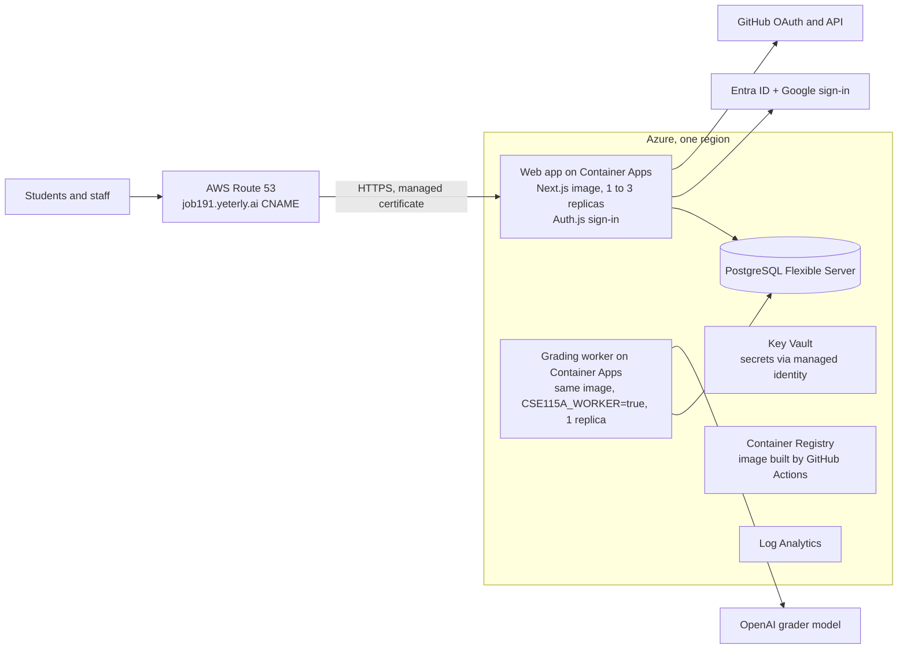

# Job191 Repo Metrics: Azure deployment plan

Proposed 2026-10-13. Status: plan, not started. Editable copy: [shared doc](https://claude.ai/code/artifact/bb69a0a0-d31a-4f63-8797-ee2dd92ffda3).

Run the existing Docker image on Azure Container Apps, move the data to Azure Database for PostgreSQL, and replace Supabase Auth with Auth.js inside the app. Point job191.yeterly.ai at it with a CNAME in Route 53. The code is the Yeterly fork of ts-repo-metrics, branch feat/cse115a-g05fb9 (commit 4ad1626).

## Summary

- **Hosting:** Azure Container Apps, with two apps built from the image that already exists: the web app, and one grading worker.
- **Database:** Azure Database for PostgreSQL Flexible Server. The 11 existing SQL migrations carry over almost unchanged once the Supabase-only parts are removed.
- **Sign-in:** Auth.js (NextAuth v5) in the Next.js app, with Microsoft Entra ID for Istinye student accounts, Google for the admin accounts, and GitHub for repository access. Sessions and linked accounts are stored in the same Postgres database.
- **Secrets:** Azure Key Vault, read by the apps through a managed identity.
- **Domain:** job191.yeterly.ai, a CNAME in AWS Route 53, with a free managed certificate from Container Apps.
- **Biggest piece of work:** replacing the Supabase client calls in about 55 files. Rough estimate: 5 to 8 developer days, plus 2 for infrastructure and testing.

## What Supabase does today

The app uses Supabase for two things, sign-in and Postgres. It does not use Supabase file storage or realtime, so nothing else needs replacing.

| Area | How the app uses it | Where in the code |
| --- | --- | --- |
| Google sign-in | `signInWithOAuth` and `linkIdentity` for Google, then a check that the email is verified and on the allow list | `UcscGoogleButton.tsx`, `auth/callback/route.ts`, `lib/courseUcscAuth.ts` |
| GitHub link | GitHub OAuth linked to the same user. The provider token is saved encrypted in `user_github_tokens` so the app can read private PRs | `auth/callback/route.ts`, `GITHUB_OAUTH_ENCRYPTION_KEY` |
| Sessions | Cookie session refreshed in `middleware.ts`, read with `auth.getUser()` (13 call sites) | `middleware.ts`, `lib/supabase/*` |
| Database | 14 tables queried with the supabase-js builder: `analyses`, 12 `cse_*` course tables, `user_github_tokens` | about 55 files |
| Server access | Most course routes use the service-role key and check identity and membership in code | `lib/cse115a/server.ts`, `instructorApi.ts` |
| Row-level security | 8 policies that use `auth.uid()`. About 9 API routes use a user-scoped client that relies on them, mostly for `analyses` | `supabase/migrations/*`, `lib/supabase/server-user.ts` |
| SQL functions | 4 RPC calls: `submit_cse_assignment`, `release_cse_assignment_submission`, `requeue_cse_grading_job`, `claim_cse_grading_job` | grading worker, instructor routes |
| Schema | 11 migration files (about 500 lines). User columns have foreign keys to `auth.users` | `supabase/migrations/` |

## Replacing Supabase

Supabase is replaced by three parts: Auth.js for sign-in, plain Postgres on Azure for data, and a small typed data layer in the app.

**Sign-in with Auth.js (NextAuth v5)**

- Providers: Microsoft Entra ID for students, because Istinye email runs on Microsoft 365. Google stays for the admin accounts on other domains, and GitHub is for repository access. A student is accepted only when the token's tenant ID (`tid`) is Istinye's tenant, because Entra's `email` claim is not verified on its own.
- The allow list moves into the Auth.js `signIn` callback. It keeps the current rules: any verified `@stu.istinye.edu.tr` account, the three admin emails from any domain, and everyone else rejected.
- GitHub is linked to the signed-in user as a second account. Its access token is written to the existing encrypted `user_github_tokens` store.
- Sessions are stored in the database through the Auth.js Postgres adapter (tables `users`, `accounts`, `sessions`, `verification_token`).
- This replaces `middleware.ts`, `/auth/callback`, `getCourseIdentity()`, the Google button and the GitHub connect flow.
- New callback URLs: `https://job191.yeterly.ai/api/auth/callback/microsoft-entra-id`, `/google` and `/github`. They go on a Yeterly app registration in Entra ID, a Google OAuth client and a GitHub OAuth app.

**Data access**

- Replace supabase-js with Kysely on node-postgres, with one module per area: courses, submissions, grading jobs, benchmark, analyses and tokens. Most changes are mechanical, one builder chain for another.
- The 4 SQL functions stay in Postgres and are called with `select fn(...)`.
- Authorization stays in the API routes, which already check identity, course membership and staff roles. The routes that relied on row-level security get explicit `user_id` filters.

**Migrations**

- Copy the 11 files into a plain Postgres migration folder, run in order by `node-pg-migrate`.
- Change foreign keys from `auth.users(id)` to the Auth.js `users(id)`.
- Remove the `auth.uid()` policies and Supabase role grants, and keep the tables, indexes and functions.
- No data is migrated. Job191 starts with an empty database.

## Azure architecture

Both apps run the same image and read and write the same Postgres database. Only the worker calls the grader model. The repository's existing Dockerfile and `/api/health` endpoint work on Container Apps as they are.

| Service | Starting size | Approx. monthly cost |
| --- | --- | --- |
| Container Apps, web | 1 vCPU, 2 GiB, 1 to 3 replicas | $0 to 30 |
| Container Apps, worker | 0.5 vCPU, 1 GiB, 1 replica | $10 to 20 |
| PostgreSQL Flexible Server | Burstable B1ms, 32 GB, backups on | $15 to 25 |
| Container Registry | Basic | $5 |
| Key Vault, Log Analytics | pay per use | under $10 |

The total is about $40 to 90 a month at class scale, plus OpenAI grading calls. These are approximate list prices from memory and need checking against the Azure pricing calculator for the chosen region.

## Environment variables

- **Remove:** `NEXT_PUBLIC_SUPABASE_URL`, `NEXT_PUBLIC_SUPABASE_ANON_KEY`, `SUPABASE_URL`, `SUPABASE_ANON_KEY`, `SUPABASE_SERVICE_ROLE_KEY`.
- **Add:** `DATABASE_URL`, `AUTH_SECRET`, `AUTH_MICROSOFT_ENTRA_ID_ID`, `AUTH_MICROSOFT_ENTRA_ID_SECRET`, `AUTH_MICROSOFT_ENTRA_ID_ISSUER` (Istinye tenant), `AUTH_GOOGLE_ID`, `AUTH_GOOGLE_SECRET`, `AUTH_GITHUB_ID`, `AUTH_GITHUB_SECRET`, and `APP_ORIGIN=https://job191.yeterly.ai`.
- **Keep:** `GITHUB_OAUTH_ENCRYPTION_KEY`, `OPENAI_API_KEY`, `CSE115A_SITE=true`, `CSE115A_WORKER` (worker only), `CSE115A_ALLOWED_EMAIL_DOMAINS`, `NEXT_PUBLIC_CSE115A_ALLOWED_EMAIL_DOMAINS`, `CSE115A_ADMIN_EMAILS`, and the `NEXT_PUBLIC_COURSE_*` names.
- Secrets live in Key Vault. `NEXT_PUBLIC_*` values are inlined at build time, so they are passed as Docker build arguments.

## Domain: job191.yeterly.ai

The domain needs two records in the yeterly.ai hosted zone in Route 53, and the certificate is issued by Azure for free.

1. In Azure, add the custom domain `job191.yeterly.ai` to the web container app. Azure shows a domain verification code.
2. In Route 53, add the two records below.
3. Back in Azure, bind the domain with a managed certificate. Azure renews it automatically.
4. Set `APP_ORIGIN` and the Auth.js URL to `https://job191.yeterly.ai`, and register the callback URLs with Google and GitHub.

| Type | Name | Value | TTL |
| --- | --- | --- | --- |
| TXT | `asuid.job191.yeterly.ai` | the verification code from Azure | 300 |
| CNAME | `job191.yeterly.ai` | `<web app>.<environment>.<region>.azurecontainerapps.io` | 300 |

No DNS hosting moves to Azure, and no other yeterly.ai record changes.

## Rollout

Five phases, about 7 to 10 developer days in total. Each phase ends with a check that has to pass before the next one starts.

1. **Infrastructure as code (about 1 day).** Bicep in the repo for the resource group, registry, Container Apps environment, Postgres, Key Vault and Log Analytics. A GitHub Actions workflow logs in to Azure with OIDC, builds the image and deploys it. *Check:* the current UI-only build runs on the Azure URL and `/api/health` returns 200.
2. **Plain Postgres and data layer (2 to 3 days).** Port the migrations, add Kysely and replace the supabase-js calls area by area, keeping the existing tests green. *Check:* all dashboard tests pass, and a local run against Postgres in Docker can create a course and a course code.
3. **Auth.js sign-in (about 2 days).** Microsoft Entra ID, Google and GitHub providers, the tenant check and allow list in the `signIn` callback, GitHub token storage, and removing Supabase from `middleware.ts` and the callback route. *Check:* a `@stu.istinye.edu.tr` account and one admin account sign in, and an outside account is refused.
4. **Domain and staging run (about 1 day).** Add the Route 53 records, bind the certificate, and set the OAuth callback URLs. *Check:* a full pass on `https://job191.yeterly.ai`. Sign in, link GitHub, add two PRs, submit, let the worker grade, then release as an instructor.
5. **Go live (half a day).** Create the Job191 course record and course code, add staff, replace the Railway and UCSC setup docs with an Azure guide, and fill `<APP_URL>` in the student instructions. *Check:* the first real student submission goes through.

## Open questions and risks

- [ ] **Student accounts:** Istinye accounts are on Microsoft 365, so students sign in with Entra ID. Still needed: Istinye's tenant ID, and whether university IT must approve the app (admin consent) before students can sign in.
- [ ] **Azure:** which subscription and resource group, and is Germany West Central acceptable? Azure has no Turkey region. A European region keeps latency low, but KVKK rules on transferring student data abroad should be confirmed.
- [ ] **Route 53:** is yeterly.ai already a hosted zone there, and who can add records?
- [ ] **Grader model:** keep OpenAI `gpt-4o` with a Yeterly key, or move to Azure OpenAI? Azure OpenAI keeps data in the same tenant but needs a small client change.
- [ ] **Research consent and benchmark export:** the consent text is still a UCSC IRB placeholder. Export stays off until Istinye-approved wording is in place.

- **Risk, private repositories:** students must grant the GitHub OAuth app access to their team's organization, or the app cannot read their pull requests. The student instructions should say this.
- **Risk, cold starts:** analysis clones each repository into the container. Keep at least one web replica running, and size it at 1 vCPU and 2 GiB to begin with.
