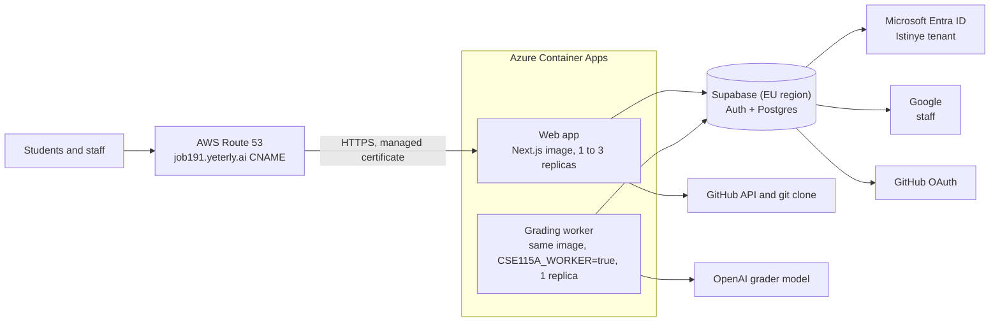

# Job191 Repo Metrics: Azure deployment plan

Revised 2026-10-13: keep Supabase. Status: plan, in progress. Editable copy: [shared doc](https://claude.ai/code/artifact/bb69a0a0-d31a-4f63-8797-ee2dd92ffda3).

Run the existing Docker image on Azure Container Apps, keep Supabase (a new Job191 project) for sign-in and Postgres, and point job191.yeterly.ai at the app with a CNAME in Route 53. Students sign in with Microsoft, because Istinye email runs on Microsoft 365. The code is the Yeterly fork of ts-repo-metrics, branch `feat/cse115a-g05fb9`.

## Decisions

- **Keep Supabase.** It already handles Google, GitHub and Microsoft sign-in, sessions, Postgres and row-level security. Replacing it would have cost 7 to 10 developer days. Use the Pro plan for the live course (about $25 a month: no pausing, daily backups). The free plan pauses after a week without activity and has no backups, so use it only for testing.
- **Hosting:** Azure Container Apps, with two apps built from the repo's existing `Dockerfile`: the web app (1 to 3 replicas) and one grading worker (`CSE115A_WORKER=true`, exactly 1 replica).
- **Sign-in:** Microsoft (the Supabase `azure` provider) for students, restricted to Istinye's tenant, with a one-time code emailed to the student's university address as the fallback. Google for staff on other domains who are on the admin list. GitHub for repository access. None of this needs Istinye IT.
- **Domain:** job191.yeterly.ai, a CNAME in AWS Route 53, with a free managed certificate from Container Apps.

## Architecture

Images are built by GitHub Actions and pushed to Azure Container Registry. Secrets live in Key Vault (or Container Apps secrets), and logs go to Log Analytics.

| Service | Starting size | Approx. monthly cost |
| --- | --- | --- |
| Supabase | Pro, EU region (Frankfurt) | about $25 |
| Container Apps, web | 1 vCPU, 2 GiB, 1 to 3 replicas | $0 to 30 |
| Container Apps, worker | 0.5 vCPU, 1 GiB, 1 replica | $10 to 20 |
| Container Registry | Basic | $5 |
| Key Vault, Log Analytics | pay per use | under $10 |

These are approximate list prices and need checking for the chosen region. OpenAI grading calls are extra.

## Supabase project setup

1. **Region:** an EU region such as Frankfurt, for student data.
2. **Schema:** apply the migrations in `supabase/migrations/` in order. Either `supabase link --project-ref <ref>` then `supabase db push`, or paste each file into the SQL editor oldest first.
3. **Microsoft provider (students):**
   - Istinye's tenant ID is `8f3fdacc-a839-4a7d-a9c8-36b7cb8df4a2` (public; both @stu.istinye.edu.tr and @istinye.edu.tr are in it).
   - In Yeterly's own Microsoft Entra, register a web app as **multitenant** ("Accounts in any organizational directory") with the redirect URI `https://<project-ref>.supabase.co/auth/v1/callback`, and create a client secret.
   - In Supabase **Authentication > Providers > Azure**, enable it, paste the client ID and secret, and set **Azure Tenant URL** to `https://login.microsoftonline.com/8f3fdacc-a839-4a7d-a9c8-36b7cb8df4a2`.
   - Set `CSE115A_MICROSOFT_TENANT_ID=8f3fdacc-a839-4a7d-a9c8-36b7cb8df4a2` on the app. The app refuses Microsoft accounts from any other tenant, and refuses Microsoft entirely if this is not set.
   - Each student approves the app on first sign-in. If Istinye blocks user consent, students see "Need admin approval" and use the emailed code instead.
4. **Emailed code (student fallback):**
   - Set up a sending service as custom SMTP in **Authentication > Emails > SMTP settings**, for example Amazon SES with a `no-reply@yeterly.ai` sender and its SPF and DKIM records in Route 53. Supabase's built-in mailer is for testing only.
   - Edit the **Magic Link** and **Confirm signup** email templates to show the code, `{{ .Token }}`, instead of a link. The app asks students to type the code.
   - Keep the Email provider enabled. The app accepts an emailed-code sign-in only for a confirmed address on the allow list.
5. **Google provider (staff):** a Google OAuth client with the same Supabase callback URL.
6. **GitHub provider:** a GitHub OAuth app owned by Yeterly, with the same Supabase callback URL.
7. **Sign-up allow list:** fill `cse_signup_allowlist` with the allowed domain and the admin emails (`insert into public.cse_signup_allowlist values ('stu.istinye.edu.tr'), ('<admin email>');`), then enable **Authentication > Hooks > Before User Created** with the Postgres function `public.cse_before_user_created`. Supabase then refuses any new account outside the list, whichever sign-in method is used.
8. **Auth settings:** turn on **manual identity linking**. Set **Site URL** to `https://job191.yeterly.ai`, and add `https://job191.yeterly.ai/auth/callback` and `http://localhost:3015/auth/callback` to the redirect URLs.
9. **Course data:** insert the Job191 row in `cse_courses` with the Job191 title, add `cse_sprints` due dates, then run `apps/dashboard/scripts/createCourseCode.mjs` and `addCourseStaff.mjs`.

## Environment variables

| Variable | Where | Value |
| --- | --- | --- |
| `NEXT_PUBLIC_SUPABASE_URL`, `NEXT_PUBLIC_SUPABASE_ANON_KEY` | build argument and runtime | from the Supabase project |
| `SUPABASE_URL`, `SUPABASE_ANON_KEY` | runtime | same values |
| `SUPABASE_SERVICE_ROLE_KEY` | runtime secret | from the Supabase project |
| `GITHUB_OAUTH_ENCRYPTION_KEY` | runtime secret | a long random string |
| `OPENAI_API_KEY` | worker secret | Yeterly's key |
| `APP_ORIGIN` | runtime | `https://job191.yeterly.ai` |
| `CSE115A_SITE` | runtime | `true` |
| `CSE115A_WORKER` | worker only | `true` |
| `CSE115A_ALLOWED_EMAIL_DOMAINS` | runtime | `stu.istinye.edu.tr` |
| `NEXT_PUBLIC_CSE115A_ALLOWED_EMAIL_DOMAINS` | build argument | `stu.istinye.edu.tr` |
| `CSE115A_ADMIN_EMAILS` | runtime | the three admin emails |
| `CSE115A_MICROSOFT_TENANT_ID` | runtime | `8f3fdacc-a839-4a7d-a9c8-36b7cb8df4a2` |
| `NEXT_PUBLIC_COURSE_*` | build argument | optional overrides |

`NEXT_PUBLIC_*` values are inlined at build time, so they must be passed as Docker build arguments. The current `Dockerfile` declares only the two Supabase ones, so the course ones need adding there too.

## Domain: job191.yeterly.ai

1. In Azure, add the custom domain `job191.yeterly.ai` to the web container app. Azure shows a domain verification code.
2. In the yeterly.ai hosted zone in Route 53, add the records below.
3. Back in Azure, bind the domain with a managed certificate. Azure renews it automatically.

| Type | Name | Value | TTL |
| --- | --- | --- | --- |
| TXT | `asuid.job191.yeterly.ai` | the verification code from Azure | 300 |
| CNAME | `job191.yeterly.ai` | `<web app>.<environment>.<region>.azurecontainerapps.io` | 300 |

## Rollout

1. **Supabase project (half a day).** Region, migrations, providers and auth settings as above. *Check:* sign in locally against it on `http://localhost:3015` with an Istinye Microsoft account and an admin Google account. An account from another tenant is refused.
2. **Azure infrastructure (about 1 day).** Bicep in the repo for the resource group, registry, Container Apps environment, the two apps and Log Analytics. A GitHub Actions workflow logs in with OIDC, builds with the build arguments and deploys. *Check:* `/api/health` returns 200 on the Azure URL.
3. **Domain (about 1 hour plus DNS time).** Route 53 records and the managed certificate. *Check:* `https://job191.yeterly.ai` serves the app.
4. **Staging run (half a day).** Sign in, enter the course code, link GitHub, add two PRs, submit, let the worker grade, then release as an instructor.
5. **Go live.** Fill `<APP_URL>`, `<TERM>` and `<COURSE_LMS>` in the student instructions and share the course code.

## Open questions

- [x] **Tenant ID:** `8f3fdacc-a839-4a7d-a9c8-36b7cb8df4a2`, found from Microsoft's public endpoints.
- [ ] **Consent test:** one student signs in with Microsoft. If they see "Need admin approval", students use the emailed code.
- [ ] **Email delivery:** send one code to a student mailbox and check it isn't filtered as junk.
- [ ] **Azure:** which subscription and resource group, and which region? Azure has no Turkey region; KVKK rules on student data abroad should be confirmed.
- [ ] **Route 53:** is yeterly.ai already a hosted zone there, and who can add records?
- [ ] **Research consent:** the consent text is still a UCSC IRB placeholder, so the benchmark export stays off until Istinye-approved wording is in place.

- **Risk, private repositories:** students must grant the GitHub OAuth app access to their team's organization, or the app cannot read their pull requests.
- **Risk, admin accounts:** the three admin emails sign in with Google. If any of them is not a Google account, it needs another route, such as being added as a guest in the Istinye tenant.
